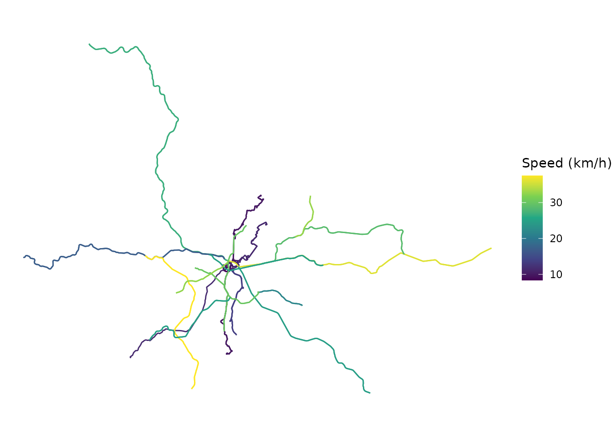
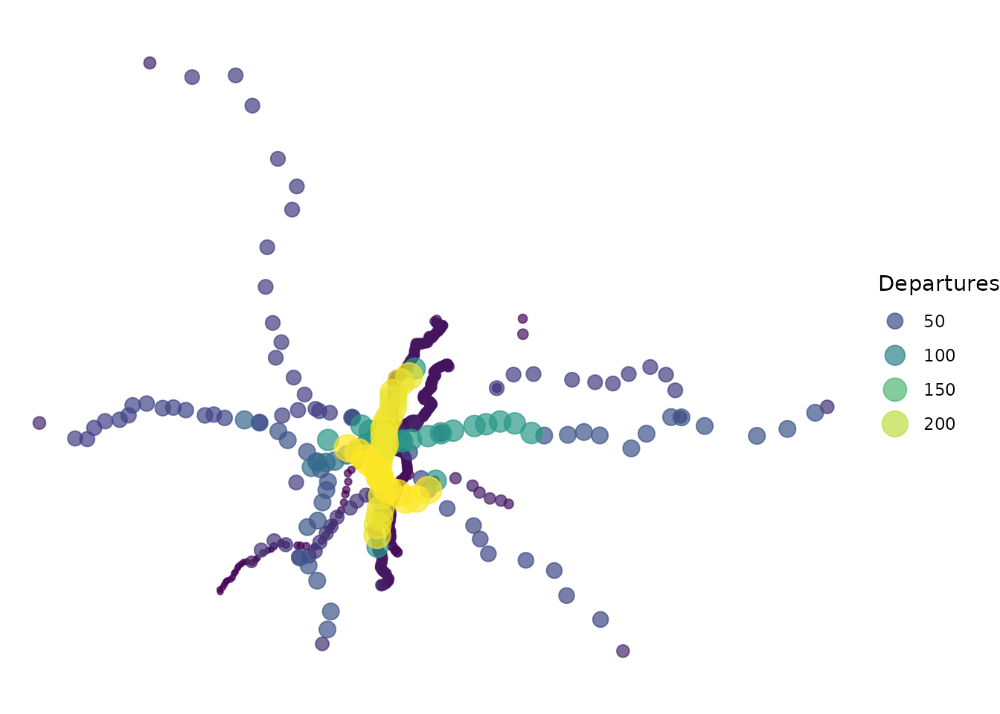

# Mapping GTFS feeds

Maps are often the best way to get a sense of a transit network: where
its routes run, how fast they are and which stops are the busiest.
**gtfstools** includes a few functions that convert the tables of a GTFS
feed into spatial `sf` objects, which can be easily mapped with
[ggplot2](https://ggplot2.tidyverse.org). This vignette will show you
how to map a feed using the following functions:

- [`get_shapes_geometry()`](https://ipea.github.io/gtfstools/reference/get_shapes_geometry.md):
  converts the `shapes` table into `LINESTRING`s;
- [`get_route_geometry()`](https://ipea.github.io/gtfstools/reference/get_route_geometry.md):
  returns the distinct trip geometries of each route;
- [`get_stops_geometry()`](https://ipea.github.io/gtfstools/reference/get_stops_geometry.md):
  converts the `stops` table into `POINT`s.

We will start by loading the packages required by this demonstration
into the current **R** session:

``` r

library(gtfstools)
library(ggplot2)
library(dplyr)
```

## Mapping the transit network

[`get_shapes_geometry()`](https://ipea.github.io/gtfstools/reference/get_shapes_geometry.md)
converts the `shapes` table into an `sf` object with the geometry of
each shape. Mapping them gives an overview of the whole network
described in the feed. Let’s see how that works using São Paulo’s feed:

``` r

path <- system.file("extdata/spo_gtfs.zip", package = "gtfstools")
gtfs <- read_gtfs(path)
```

``` r

shapes <- get_shapes_geometry(gtfs)

ggplot() +
  geom_sf(data = shapes) +
  theme_void()
```


## Mapping routes by speed

Spatial objects become more interesting when combined with other
information about the feed. Let’s map the routes by their average speed.
First, we calculate summary statistics of the speeds of the trips of
each route with
[`get_route_speed()`](https://ipea.github.io/gtfstools/reference/get_route_speed.md).
We use `mean_speed`, the simple mean of the speeds of the trips of each
route (frequency-based trips count once, regardless of their headway):

``` r

route_speed <- get_route_speed(gtfs)

head(route_speed)
#>    route_id min_speed mean_speed median_speed max_speed  sd_speed
#>      <char>     <num>      <num>        <num>     <num>     <num>
#> 1:  2002-10  8.360838   8.360838     8.360838  8.360838        NA
#> 2:  2105-10  9.651135   9.951090     9.951090 10.251044 0.4241997
#> 3:  2161-10 11.172445  11.398943    11.398943 11.625440 0.3203161
#> 4:  4491-10 12.011979  13.585046    13.585046 15.158114 2.2246538
#> 5:  5290-10  9.103782   9.870054     9.870054 10.636326 1.0836719
#> 6:  6450-51 11.450417  11.450417    11.450417 11.450417        NA
```

Then, we join these speeds to the geometries returned by
[`get_route_geometry()`](https://ipea.github.io/gtfstools/reference/get_route_geometry.md),
which includes one row for each distinct geometry of a route’s trips
(e.g. one for each direction):

``` r

# the sf object comes first, so that the result is also an sf object
routes <- get_route_geometry(gtfs) |>
  dplyr::inner_join(route_speed, by = "route_id")

ggplot() +
  geom_sf(data = routes, aes(color = mean_speed)) +
  scale_color_viridis_c(name = "Speed (km/h)") +
  theme_void()
```



## Mapping stops by frequency

Similarly, we can map the stops by the number of departures from each
one of them in the morning peak, calculated with
[`get_stop_frequency()`](https://ipea.github.io/gtfstools/reference/get_stop_frequency.md).
Since the departures are counted by service, we first keep only the
services that run on mondays with
[`filter_by_weekday()`](https://ipea.github.io/gtfstools/reference/filter_by_weekday.md),
and then add up the departures of each stop:

``` r

weekday_gtfs <- filter_by_weekday(gtfs, "monday")

stop_frequency <- get_stop_frequency(
  gtfs = weekday_gtfs,
  from = "07:00:00",
  to = "09:00:00"
)

stop_frequency <- stop_frequency |>
  dplyr::group_by(stop_id) |>
  dplyr::summarise(
    departures = sum(departures), 
    .groups = "drop"
    )
```

[`get_stops_geometry()`](https://ipea.github.io/gtfstools/reference/get_stops_geometry.md)
converts the stops into points, to which we join the number of
departures. The size and the color of each stop vary with its number of
departures:

``` r

stops <- get_stops_geometry(gtfs, stop_id = stop_frequency$stop_id)

stops <- stops |>
  dplyr::inner_join(stop_frequency, by = "stop_id")

# draws the busiest stops on top
stops <- stops |>
  dplyr::arrange(departures)

ggplot() +
  geom_sf(
    data = stops,
    aes(color = departures, size = departures),
    alpha = 0.7
  ) +
  scale_color_viridis_c(guide = "legend") +
  labs(color = "Departures", size = "Departures") +
  theme_void()
```



**Note:**

The speeds and frequencies used above are just two examples of the
information that can be extracted from a feed. For more information on
these and other functions, please see the [querying
vignette](https://ipea.github.io/gtfstools/articles/querying.md) and the
[function
reference](https://ipea.github.io/gtfstools/reference/index.html).
