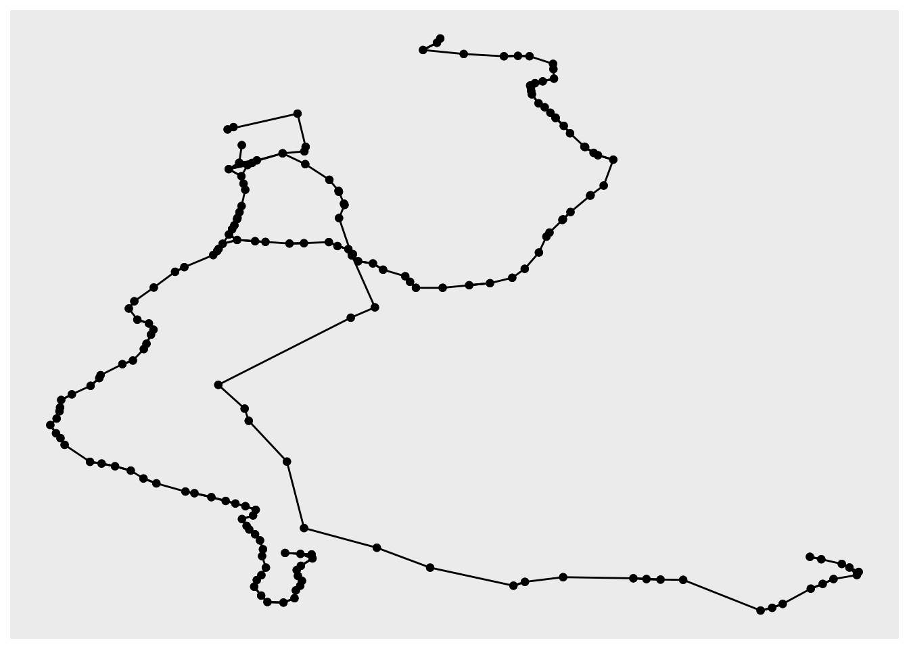
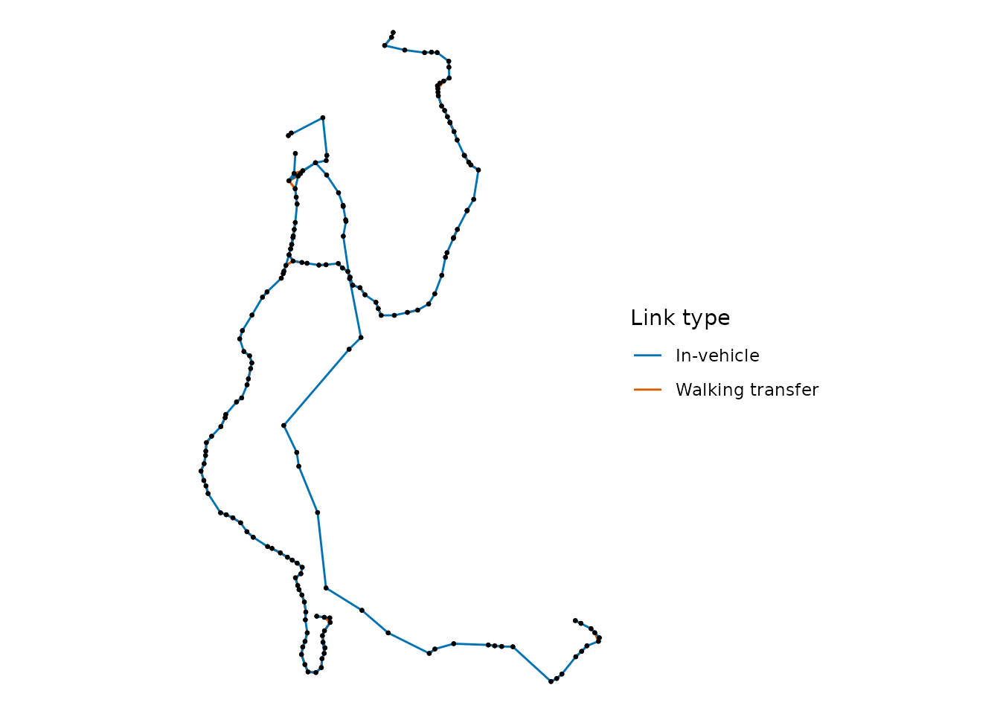

# Building transit network graphs

Many transport analyses, such as network centrality and transit
assignment models, are carried out on a graph of the transit network
rather than on its timetable.
[`build_graph()`](https://ipea.github.io/gtfstools/dev/reference/build_graph.md)
builds such a graph from the trips of a GTFS feed that depart within a
period of day. The graph has two types of nodes:

- **stop** nodes, one per stop, the physical place where a passenger
  stands;
- **service** nodes, one for each route and direction at each stop it
  serves.

obs. this way, a stop served by routes 1 and 2, both in one direction,
gets *one stop node* and *two service nodes*, all at the same
coordinates.

And four types of links:

- **in-vehicle** links between the service nodes of consecutive stops,
  with the mean travel time between them;
- **boarding** links from each stop to the service nodes from which
  trips depart, with the number of departures and the mean waiting time
  (half the headway);
- **alighting** links from each service node back to its stop;
- walking **transfer** links between nearby stops.

The graph can be returned as tables following the General Modeling
Network Specification (GMNS), or as an [igraph](https://r.igraph.org/)
or [tidygraph](https://tidygraph.data-imaginist.com) graph. This
vignette shows how to build a transit network graph from GTFS feeds and
how to analyse and plot the network with these packages like
[sfnetworks](https://luukvdmeer.github.io/sfnetworks/) and
[ggraph](https://ggraph.data-imaginist.com). Please see the
documentation of
[`build_graph()`](https://ipea.github.io/gtfstools/dev/reference/build_graph.md)
for the details of how nodes and links are built.

## Preparing the feed

We will use the sample feed of Porto Alegre, included in the package,
and build the network of the morning peak, from 7am to 10am.
[`build_graph()`](https://ipea.github.io/gtfstools/dev/reference/build_graph.md)
pools the trips of every service in the feed. In this example, we will
remove services running on weekends with
[`filter_by_weekday()`](https://ipea.github.io/gtfstools/dev/reference/filter_by_weekday.md):

``` r

library(gtfstools)
library(dplyr)
#> 
#> Attaching package: 'dplyr'
#> The following objects are masked from 'package:stats':
#> 
#>     filter, lag
#> The following objects are masked from 'package:base':
#> 
#>     intersect, setdiff, setequal, union

path <- system.file("extdata/poa_gtfs.zip", package = "gtfstools")
gtfs <- read_gtfs(path)

gtfs <- filter_by_weekday(
  gtfs,
  weekday = c("saturday", "sunday"), 
  keep = FALSE
  )
```

Oftentimes, a GTFS feed comes with a few inconsistencies, such as
duplicated trips, unused stops, etc. This particular feed lists only the
times of the first and the last stop of each trip, and the links between
stops without times would have no travel time, so they couldn’t be used
to calculate travel times through the network. Here we will use the
[`fix_gtfs()`](https://ipea.github.io/gtfstools/dev/reference/fix_gtfs.md)
function to fix several of these inconsistencies. We also want to ensure
that no trips exceed 25 km/h and that all trips have a minimum dwell
time of 30 seconds to allow passengers to board and alight.

``` r

gtfs <- fix_gtfs(gtfs)
```

obs. in this case,
[`fix_gtfs()`](https://ipea.github.io/gtfstools/dev/reference/fix_gtfs.md)
throws a warning that refers to a few late night trips whose times go
back to “00:00:00” after midnight, which depart outside the time of day
used below:

## Building a GMNS network

By default,
[`build_graph()`](https://ipea.github.io/gtfstools/dev/reference/build_graph.md)
returns the GMNS `node`, `link` and `config` tables:

``` r

g_gmns <- build_graph(
  gtfs, 
  from = "07:00:00", 
  to = "10:00:00", 
  format = "gmns"
  )

head(g_gmns$node)
#>    node_id   x_coord   y_coord node_type parent_node_id stop_id
#>      <int>     <num>     <num>    <char>          <int>  <char>
#> 1:       1 -51.20856 -30.14726      stop             NA    1065
#> 2:       2 -51.20095 -30.15292      stop             NA     126
#> 3:       3 -51.24399 -30.07915      stop             NA    1323
#> 4:       4 -51.24321 -30.07709      stop             NA    1326
#> 5:       5 -51.23117 -30.06218      stop             NA    1427
#> 6:       6 -51.23059 -30.06072      stop             NA    1434
#>                    stop_name route_id direction_id inferred_direction visit
#>                       <char>   <char>        <int>              <int> <int>
#> 1:              JUCA BATISTA     <NA>           NA                 NA    NA
#> 2:              JUCA BATISTA     <NA>           NA                 NA    NA
#> 3:            PINHEIRO BORDA     <NA>           NA                 NA    NA
#> 4:            PINHEIRO BORDA     <NA>           NA                 NA    NA
#> 5: MENINO DEUS PADRE CACIQUE     <NA>           NA                 NA    NA
#> 6: MENINO DEUS PADRE CACIQUE     <NA>           NA                 NA    NA

head(g_gmns$link)
#>    link_id from_node_id to_node_id directed    length free_speed  link_type
#>      <int>        <int>      <int>   <lgcl>     <num>      <num>     <char>
#> 1:       1          184        185     TRUE  965.4371   27.80459 in_vehicle
#> 2:       2          185        201     TRUE 1279.7466   29.34451 in_vehicle
#> 3:       3          186        187     TRUE  241.8582   25.60852 in_vehicle
#> 4:       4          187        338     TRUE  510.1041   25.50520 in_vehicle
#> 5:       5          188        189     TRUE  171.8830   25.78245 in_vehicle
#> 6:       6          189        190     TRUE  307.4807   25.74257 in_vehicle
#>    travel_time departures route_id direction_id inferred_direction
#>          <num>      <int>   <char>        <int>              <int>
#> 1:   2.0833333         17      R10            1                 NA
#> 2:   2.6166667         17      R10            1                 NA
#> 3:   0.5666667          6      176            0                 NA
#> 4:   1.2000000          6      176            0                 NA
#> 5:   0.4000000          6      176            0                 NA
#> 6:   0.7166667          6      176            0                 NA

g_gmns$link |>
  dplyr::count(link_type)
#>     link_type     n
#>        <char> <int>
#> 1:  alighting   188
#> 2:   boarding   185
#> 3: in_vehicle   185
#> 4:   transfer   302
```

The tables can be written to the CSV files of a GMNS network with
[`data.table::fwrite()`](https://rdrr.io/pkg/data.table/man/fwrite.html),
as shown in the examples of
[`build_graph()`](https://ipea.github.io/gtfstools/dev/reference/build_graph.md),
and then read by other modelling software.

## Building and igraph and Calculating the centrality of stops

With `format = "igraph"`, the network is returned as an
[igraph](https://r.igraph.org/) graph, whose links have the travel time
as an attribute. We use it to calculate the shortest travel times
between every pair of stops, which include the waiting time at the stops
where vehicles are boarded:

``` r

library(igraph)
#> 
#> Attaching package: 'igraph'
#> The following objects are masked from 'package:dplyr':
#> 
#>     as_data_frame, groups, union
#> The following objects are masked from 'package:stats':
#> 
#>     decompose, spectrum
#> The following object is masked from 'package:base':
#> 
#>     union

g_igraph <- build_graph(
  gtfs, 
  from = "07:00:00", 
  to = "10:00:00", 
  format = "igraph"
  )

# get stop nodes
# stop_nodes <- igraph::V(g_igraph)[igraph::V(g_igraph)$node_type == "stop"]
stop_nodes <- igraph::V(g_igraph)[node_type == "stop"]

# get travel times between stops
travel_times <- igraph::distances(
  g_igraph,
  v = stop_nodes,
  to = stop_nodes,
  mode = "out",
  weights = igraph::E(g_igraph)$travel_time
)

# travel time from one stop to itself is NA
# an `Inf` value means {igraph} found no path for a given origin-destination pair.
diag(travel_times) <- NA
```

From these travel times, we calculate the closeness centrality of each
stop, which tell us how close a node is to all other nodes in the
network. To do this, we calculate harmonic mean of the inverse of the
travel times between each stop and the other stops. Stops that can’t be
reached count as 0. We don’t use the centrality functions of
[igraph](https://r.igraph.org/), such as
[`closeness()`](https://r.igraph.org/reference/closeness.html), because
they would also take the service nodes as destinations, and because they
require positive weights, while alighting links have a travel time of 0.
This sample feed has a single direction of each route, so the closeness
*from* a stop depends on how far it is from the end of its routes, and
the closeness *to* it on how far it is from their start. Hence we
average the closeness from and to each stop:

``` r

closeness <- data.frame(
  stop_id = stop_nodes$stop_id,
  stop_name = stop_nodes$stop_name,
  closeness_from = rowMeans(1 / travel_times, na.rm = TRUE),
  closeness_to = colMeans(1 / travel_times, na.rm = TRUE)
) |>
  dplyr::mutate(closeness = (closeness_from + closeness_to) / 2)

closeness |>
  dplyr::slice_max(closeness, n = 10)
#>     stop_id                           stop_name closeness_from closeness_to
#> 109    5065         TRES FIGUEIRAS CARLOS GOMES     0.05761972   0.04751497
#> 70     2920         TRES FIGUEIRAS CARLOS GOMES     0.05743938   0.04733027
#> 105    5056             PETROPOLIS CARLOS GOMES     0.04980748   0.04768110
#> 66     2874         TRES FIGUEIRAS CARLOS GOMES     0.04955955   0.04754615
#> 139    6133 JARDIM BOTANICO SENADOR TARSO DUTRA     0.04863296   0.04290521
#> 64     2849 JARDIM BOTANICO SENADOR TARSO DUTRA     0.04856490   0.04296696
#> 42     1784        MEDIANEIRA DR CARLOS BARBOSA     0.03617761   0.04672303
#> 41     1783        MEDIANEIRA DR CARLOS BARBOSA     0.03565377   0.04638727
#> 157    6414          MENINO DEUS PRAIA DE BELAS     0.03109753   0.04893337
#> 11     1456                      PRAIA DE BELAS     0.03077372   0.04861097
#>      closeness
#> 109 0.05256734
#> 70  0.05238483
#> 105 0.04874429
#> 66  0.04855285
#> 139 0.04576908
#> 64  0.04576593
#> 42  0.04145032
#> 41  0.04102052
#> 157 0.04001545
#> 11  0.03969235
```

## Plotting the network with tidygraph, sfnetworks and ggraph

With `format = "tidygraph"`, the network is returned as a
[tidygraph](https://tidygraph.data-imaginist.com) graph, whose nodes
have the coordinates of their stops. These coordinates can be used to
plot the network with [ggraph](https://ggraph.data-imaginist.com):

``` r

library(ggplot2)
library(ggraph)
library(tidygraph)
library(sfnetworks)
```

``` r

a <- build_graph(gtfs, from = "08:00:00", to = "10:00:00", format = "tidygraph")
a
#> # A tbl_graph: 371 nodes and 860 edges
#> #
#> # A directed simple graph with 1 component
#> #
#> # Node Data: 371 × 12 (active)
#>    name  node_id x_coord y_coord node_type parent_node_id stop_id stop_name     
#>    <chr>   <int>   <dbl>   <dbl> <chr>              <int> <chr>   <chr>         
#>  1 1           1   -51.2   -30.1 stop                  NA 1065    JUCA BATISTA  
#>  2 2           2   -51.2   -30.2 stop                  NA 126     JUCA BATISTA  
#>  3 3           3   -51.2   -30.1 stop                  NA 1323    PINHEIRO BORDA
#>  4 4           4   -51.2   -30.1 stop                  NA 1326    PINHEIRO BORDA
#>  5 5           5   -51.2   -30.1 stop                  NA 1427    MENINO DEUS P…
#>  6 6           6   -51.2   -30.1 stop                  NA 1434    MENINO DEUS P…
#>  7 7           7   -51.2   -30.1 stop                  NA 1436    PRAIA DE BELAS
#>  8 8           8   -51.2   -30.1 stop                  NA 1443    JOSE DE ALENC…
#>  9 9           9   -51.2   -30.1 stop                  NA 1444    JOSE DE ALENC…
#> 10 10         10   -51.2   -30.1 stop                  NA 1448    PRAIA DE BELAS
#> # ℹ 361 more rows
#> # ℹ 4 more variables: route_id <chr>, direction_id <int>,
#> #   inferred_direction <int>, visit <int>
#> #
#> # Edge Data: 860 × 14
#>    from    to link_id from_node_id to_node_id directed length free_speed
#>   <int> <int>   <int>        <int>      <int> <lgl>     <dbl>      <dbl>
#> 1   184   185       1          184        185 TRUE       965.       27.8
#> 2   185   201       2          185        201 TRUE      1280.       29.3
#> 3   186   187       3          186        187 TRUE       242.       25.6
#> # ℹ 857 more rows
#> # ℹ 6 more variables: link_type <chr>, travel_time <dbl>, departures <int>,
#> #   route_id <chr>, direction_id <int>, inferred_direction <int>

ggraph(a, layout = "manual", x = x_coord, y = y_coord) +
  geom_edge_link() +
  geom_node_point()
```



This plot treats longitudes and latitudes as plain coordinates. To work
with the network as spatial data, we convert it into an
[sfnetworks](https://luukvdmeer.github.io/sfnetworks/) network, in which
nodes are points and links are lines. Since boarding and alighting links
connect nodes at the same place, we keep only the in-vehicle and
transfer links, and place the in-vehicle links last, so that they are
drawn on top:

``` r

net <- a |>
  tidygraph::activate("edges") |>
  dplyr::filter(link_type %in% c("in_vehicle", "transfer")) |>
  dplyr::arrange(dplyr::desc(link_type)) |>
  sfnetworks::as_sfnetwork(
    coords = c("x_coord", "y_coord"),
    crs = 4326,
    remove = FALSE,
    edges_as_lines = TRUE,
    message = FALSE
  )

net
#> # A sfnetwork with 371 nodes and 487 edges
#> #
#> # CRS:  EPSG:4326 
#> #
#> # A directed simple graph with 61 components with spatially explicit edges
#> #
#> # Node data: 371 × 13 (active)
#>   name  node_id x_coord y_coord node_type parent_node_id stop_id stop_name      
#>   <chr>   <int>   <dbl>   <dbl> <chr>              <int> <chr>   <chr>          
#> 1 1           1   -51.2   -30.1 stop                  NA 1065    JUCA BATISTA   
#> 2 2           2   -51.2   -30.2 stop                  NA 126     JUCA BATISTA   
#> 3 3           3   -51.2   -30.1 stop                  NA 1323    PINHEIRO BORDA 
#> 4 4           4   -51.2   -30.1 stop                  NA 1326    PINHEIRO BORDA 
#> 5 5           5   -51.2   -30.1 stop                  NA 1427    MENINO DEUS PA…
#> 6 6           6   -51.2   -30.1 stop                  NA 1434    MENINO DEUS PA…
#> # ℹ 365 more rows
#> # ℹ 5 more variables: route_id <chr>, direction_id <int>,
#> #   inferred_direction <int>, visit <int>, geometry <POINT [°]>
#> #
#> # Edge data: 487 × 15
#>    from    to link_id from_node_id to_node_id directed length free_speed
#>   <int> <int>   <int>        <int>      <int> <lgl>     <dbl>      <dbl>
#> 1     3     4     559            3          4 TRUE      242.           5
#> 2     5     6     560            5          6 TRUE      172.           5
#> 3     5   151     561            5        151 TRUE       69.1          5
#> # ℹ 484 more rows
#> # ℹ 7 more variables: link_type <chr>, travel_time <dbl>, departures <int>,
#> #   route_id <chr>, direction_id <int>, inferred_direction <int>,
#> #   geometry <LINESTRING [°]>
```

`net` can be used with the functions of
[sfnetworks](https://luukvdmeer.github.io/sfnetworks/) and
[sf](https://r-spatial.github.io/sf/), for example to filter the network
by a spatial extent or to join it with other spatial data. It can also
be mapped with the `"sf"` layout of
[ggraph](https://ggraph.data-imaginist.com):

``` r

ggraph(net, layout = "sf") +
  geom_edge_sf(aes(colour = link_type)) +
  geom_node_sf(size = 0.5) +
  scale_edge_colour_manual(
    name = "Link type",
    values = c(in_vehicle = "#0072B2", transfer = "#D55E00"),
    labels = c(in_vehicle = "In-vehicle", transfer = "Walking transfer")
  ) +
  theme_void()
```


